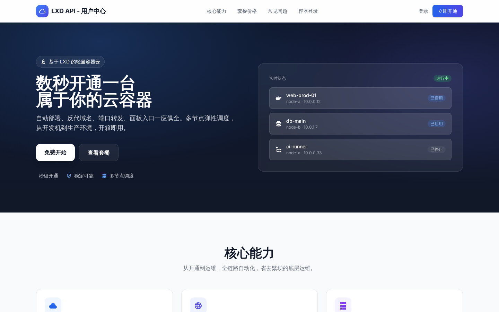
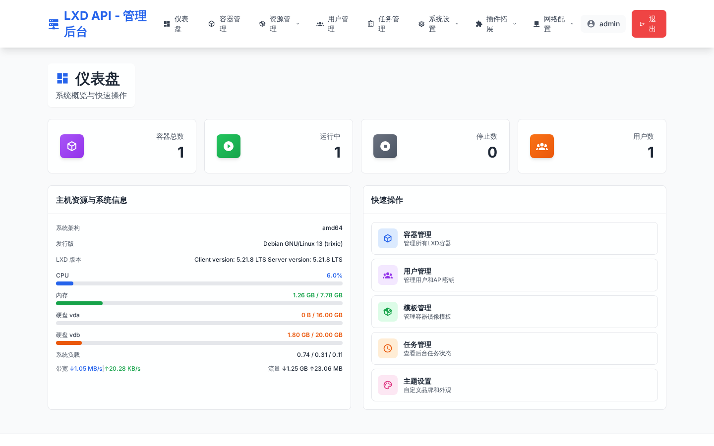
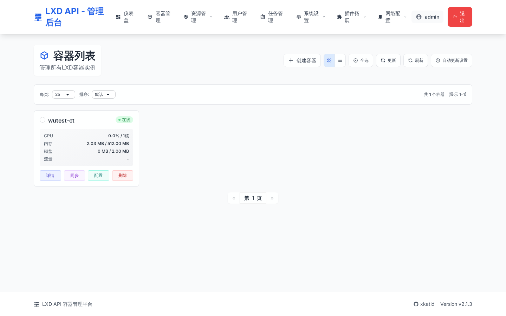
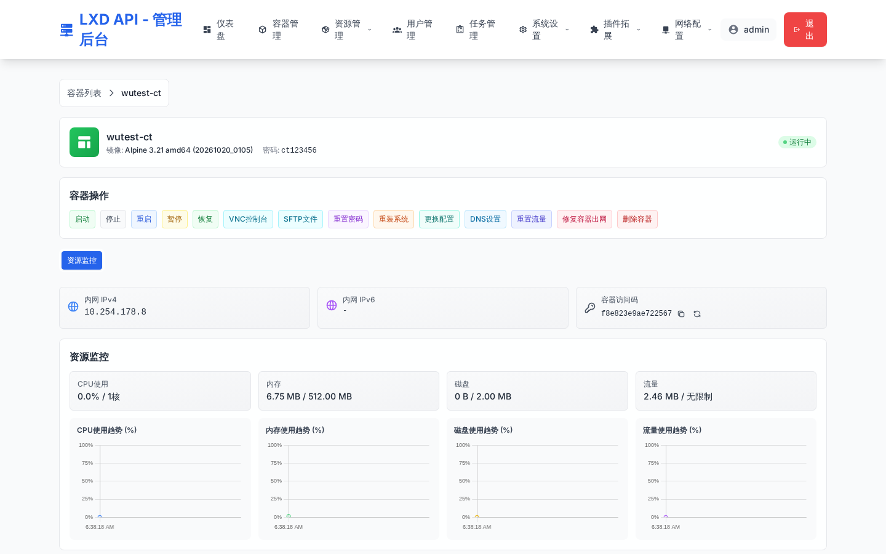
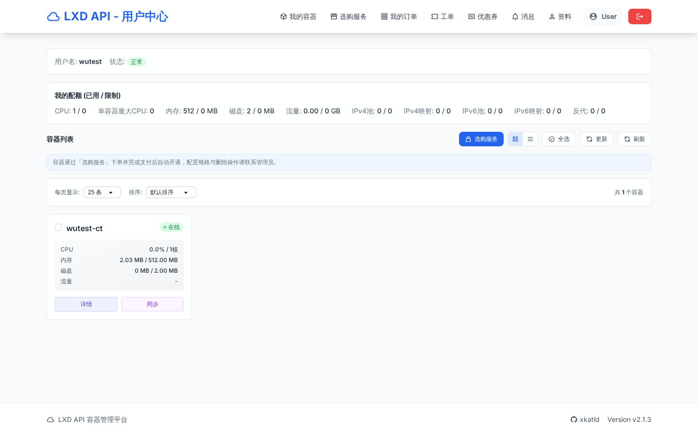
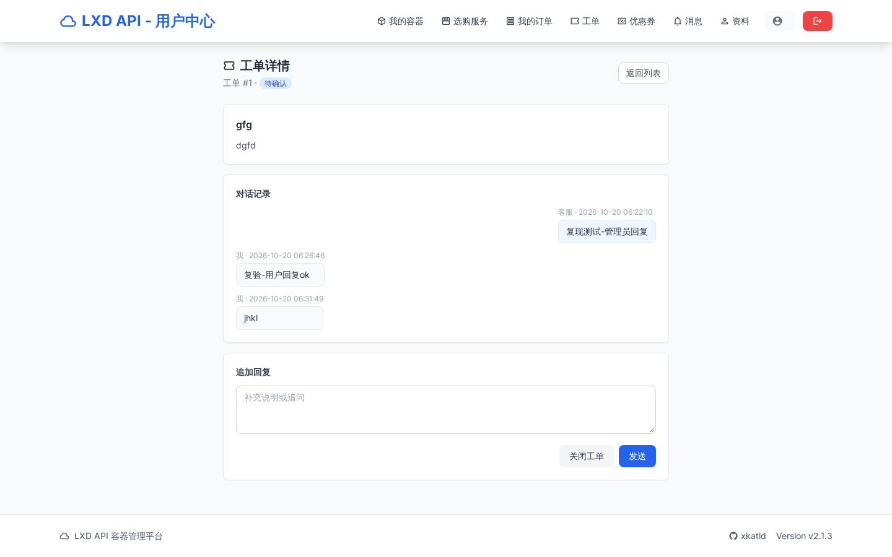
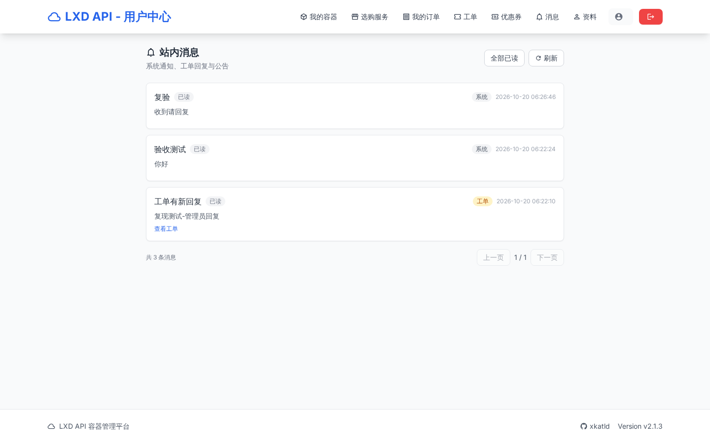
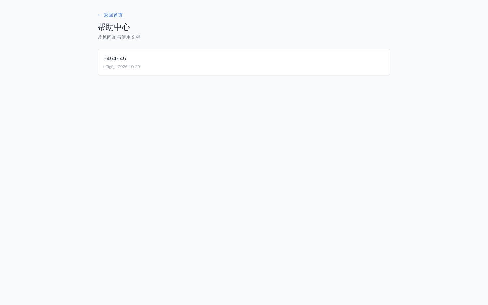
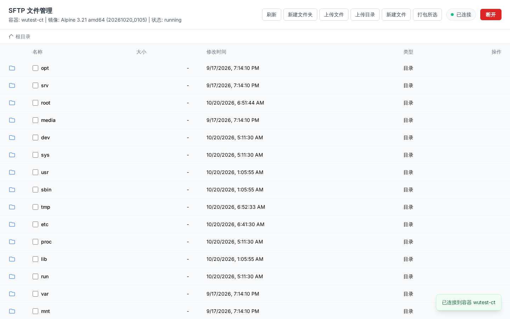
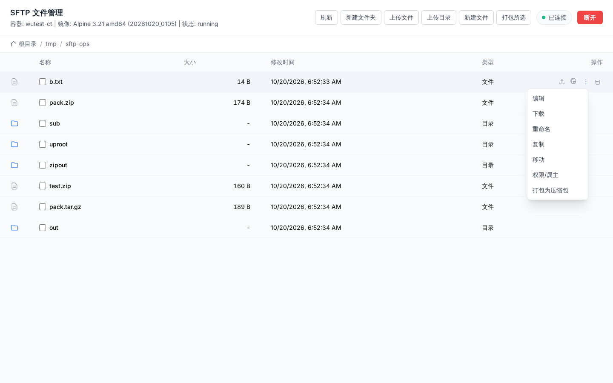

# LXD 容器管理面板（lxdapi）

基于 **LXD** 的容器管理面板：Go 后端 + 纯静态前端，支持管理后台、用户后台、容器自助面板三级体系，内置 Web 终端（WebSocket）。

- 仓库：https://github.com/qdmz/lxdapi
- 当前版本：**v0.03**

### 在线演示

| 环境 | 地址 | 说明 |
|---|---|---|
| InstaBox 演示 | https://8081-agqvpdd6dcho64yll6652vfoj4.instabox.tech | 最新版完整功能（含真实 LXD） |
| 华为云 | https://lxd.huawei.ypvps.com | 长期运行环境 |

后台初始账号 `admin`（密码见部署输出），登录后请立即修改。

### 功能一览

- **容器管理**：创建/启停/重启/重装/重置密码/删除、资源限额、实时监控、容器详情
- **Web 控制台（VNC 终端）**：WebSocket 终端，令牌一次性使用；远程节点按节点端点连接
- **SFTP 文件管理**：网页文件管理全套——列表、新建文件/文件夹、上传文件与**整个目录**（前端递归上传）、下载、**文本在线编辑**（双击打开）、删除（含非空目录递归删除）；行"更多"菜单含**重命名、复制、移动、权限/属主（chmod/chown）、打包（tar.gz/zip）、解压（tar.gz/tgz/tar/zip）**；路径统一绝对路径规范化与越界校验；容器缺 `sftp-server` 时按包管理器（apk/apt/dnf/yum）自动安装
- **多节点**：节点 CRUD、连接测试、按节点同步镜像与存储池、资源按节点区分（IP 池/NAT/防火墙/反代）
- **机房（Region）**：机房管理，节点归属机房
- **网络**：IPv4/IPv6 池、NAT 端口转发（v4/v6）、防火墙（OpenGFW 插件）、反向代理、容器出网自检与一键修复
- **电商**：产品（节点绑定/镜像/库存/多周期价格/限购/设置费/免费开通）、订单中心、易支付集成、支付回调自动开通、余额支付与**事务化退款**（流水一致、幂等）
- **用户体系**：bcrypt 密码、注册/邮箱激活/找回密码、用户配额、个人资料自助修改、管理员模拟登录（虚拟登陆）
- **营销与内容**：优惠券（领取/下单核销）、知识库（公开帮助中心 + 后台维护）
- **客服与消息**：工单系统（用户/管理员双端对话）、站内通知（计数与列表一致、定向发送到具体用户）
- **系统**：SMTP 邮件与模板、品牌设置、验证码、`/api/public/version` 与 `/healthz`

### 运行截图

| | |
|---|---|
|  |  |
|  |  |
|  |  |
|  |  |
| **SFTP 文件管理** |
|  |
| **文件操作菜单（编辑/下载/改名/复制/移动/权限/打包）** |
|  |

---

## 零、一键部署（推荐）

在全新的 Debian / Ubuntu 机器上（root 执行）：

```bash
curl -fsSL https://raw.githubusercontent.com/qdmz/lxdapi/main/scripts/install.sh | bash
```

脚本会自动完成：安装依赖 → 安装并初始化 LXD → 获取后端二进制（Release 下载，失败则源码编译）→ 生成配置（随机管理员密码 / API Hash / 会话密钥）→ 配置 systemd 与 nginx（80/443/8080 + 自签证书）→ 部署前端 → 放行容器出网（Docker 共存时自动处理）→ 制作 `debian-12-net` 基础镜像 → 启动并自检。

### 常用参数

| 参数 | 说明 |
|---|---|
| `--local /path/to/repo` | 用本地源码目录部署（离线环境） |
| `--domain panel.example.com` | 写入 nginx `server_name` |
| `--skip-lxd` | 已装好 LXD 时跳过安装与初始化 |
| `--no-image` | 不制作 debian-12-net 镜像 |
| `--tag v0.03` | 指定下载的 Release 版本 |
| `--branch main` | 指定拉取的分支 |

示例：

```bash
bash install.sh --domain heyun.ypvps.com
bash install.sh --local /root/lxdapi --skip-lxd --no-image
```

执行结束后会打印服务状态、访问地址和初始管理员密码，**请登录后立即改密码**。

> 生产环境建议：用正式证书替换 `/etc/nginx/ssl/lxdpanel.crt|key`；443 端口在国内需备案或走 CDN。

---

## 一、架构与端口

```
浏览器 ──► nginx (80 / 443 / 8080)
              ├─ 静态前端  /opt/lxdpanel
              ├─ /api/     ──► Go 后端 127.0.0.1:8081
              ├─ /ws/      ──► Go 后端（WebSocket 控制台）
              └─ /admin /user /container /swagger ──► Go 后端
                                    │
                                    └─► lxc 命令 / LXD unix socket ──► 容器
```

| 端口 | 用途 | 说明 |
|---|---|---|
| 80 / 443 | 前端入口（生产） | 443 默认自签证书，可替换 |
| 8080 | 前端入口（备用） | 内网/隧道访问常用 |
| 8081 | Go 后端 API | 不建议直接暴露公网 |

### 三个登录入口

| 入口 | 地址 | 账号 |
|---|---|---|
| 管理后台 | `/admin/login` | 配置里的 `admin.username` / `admin.password` |
| 用户后台 | `/user/login` | 用户名 + **该用户的 API Key**（用户登录密码即 API Key） |
| 容器面板 | `/login.html?hash=xxx` | 容器访问码（hash）+ 验证码 |

---

## 二、目录结构

```
server/   Go 后端源码（cmd / internal / models / pkg / plugins）
web/      静态前端（login.html、dashboard.html、console.html、js、css）
deploy/
  nginx/              lxdpanel.conf、lxdpanel-common.inc、00-xfp-map.conf
  systemd/            lxdapi.service
  config.example.yaml 脱敏配置样例
```

---

## 三、部署步骤（Debian / Ubuntu）

### 1. 安装 LXD 与依赖

```bash
apt update
apt install -y snapd nginx debootstrap rsync curl
snap install lxd
lxd init --auto        # 自动初始化存储池 default、网桥 lxdbr0
lxc storage list
lxc network list
```

### 2. 制作 Debian 12 基础镜像

```bash
debootstrap --arch=amd64 bookworm /tmp/rootfs http://mirrors.aliyun.com/debian/
tar -C /tmp/rootfs -czf /tmp/debian12.tar.gz .
lxc image import /tmp/debian12.tar.gz --alias debian-12
```

> **踩坑重点**：debootstrap 出来的 rootfs 是"裸系统"，容器内没有 `ip` 命令、没有 DHCP 客户端、没有任何网络配置，启动后**拿不到内网 IP**，面板会显示空白。
>
> 解决：先起一台容器写入网络配置，再固化成新镜像：
>
> ```bash
> lxc launch debian-12 tmp-ct
> lxc config set tmp-ct security.nesting true     # 关键：否则 systemd-networkd 报 226/NAMESPACE 起不来
> lxc exec tmp-ct -- sh -c "mkdir -p /etc/systemd/network && \
>   printf '[Match]\nName=eth0\n\n[Network]\nDHCP=yes\n' > /etc/systemd/network/80-eth0.network && \
>   systemctl enable --now systemd-networkd"
> sleep 5
> lxc list tmp-ct                                  # 此时应能看到 eth0 的 IPv4
> lxc publish tmp-ct --alias debian-12-net --force # 固化成带网络的镜像
> ```
>
> 之后创建 / 重装容器请选用 **`debian-12-net`**，否则新容器依然没有 IP。

### 3. 编译后端

```bash
cd server
GOOS=linux GOARCH=amd64 CGO_ENABLED=0 go build -o lxdapi ./cmd/lxdapi
# ARM64 机器改用 GOARCH=arm64
```

### 4. 安装到 /opt/lxdapi

```bash
mkdir -p /opt/lxdapi/configs
cp lxdapi /opt/lxdapi/
cp configs/config.yaml /opt/lxdapi/configs/    # 或用 deploy/config.example.yaml 修改后放入
```

必须修改的配置项：

| 配置项 | 说明 |
|---|---|
| `admin.password` | 管理后台密码 |
| `admin.session_secret` | 会话密钥，改成随机串 |
| `security.api_hash` | 系统级 API 密钥（`X-API-Hash` 头） |
| `lxc.socket` | LXD socket 路径，snap 安装为 `/var/snap/lxd/common/lxd/unix.socket` |

### 5. systemd 服务

```bash
cp deploy/systemd/lxdapi.service /etc/systemd/system/
systemctl daemon-reload
systemctl enable --now lxdapi
systemctl status lxdapi
```

### 6. nginx

```bash
cp deploy/nginx/*.conf deploy/nginx/*.inc /etc/nginx/conf.d/
mkdir -p /etc/nginx/ssl
openssl req -x509 -newkey rsa:2048 -nodes -days 3650 \
  -keyout /etc/nginx/ssl/lxdpanel.key -out /etc/nginx/ssl/lxdpanel.crt \
  -subj "/CN=你的域名或IP"
nginx -t && systemctl reload nginx
```

`lxdpanel-common.inc` 内含 `/api/`、`/ws/`、`/admin`、`/user`、`/swagger` 反代规则，WebSocket 超时已设 3600s。
若上游有 CDN 且 HTTP 回源，`00-xfp-map.conf` 会优先取 `X-Forwarded-Proto`，保证后端识别用户实际协议。

### 7. 部署前端

```bash
mkdir -p /opt/lxdpanel
cp -r web/* /opt/lxdpanel/
```

### 8. 验证

```bash
curl -s -o /dev/null -w "%{http_code}\n" http://127.0.0.1/login.html             # 200
curl -s -o /dev/null -w "%{http_code}\n" http://127.0.0.1/api/container/captcha  # 200
curl -s http://127.0.0.1/api/public/brand-settings                               # JSON
```

---

## 四、鉴权方式（API）

| 中间件 | 适用路由 | 认证方式 |
|---|---|---|
| `AdminAuth` | `/api/admin/*` | session cookie（先登录 `/admin/login`） |
| `UserAuthOrBasic` | `/api/user/*` | session cookie，或请求头 `X-User-Username` + `X-User-Password`（值为用户 API Key） |
| `ContainerAuth` | `/api/container/*` | 请求头 `X-Container-Hash`（容器访问码） |
| `SystemAuth` | `/api/system/*` | 请求头 `X-API-Hash` |

示例（用 API Key 免登录调用用户接口）：

```bash
curl -H "X-User-Username: test" -H "X-User-Password: <api_key>" \
  http://127.0.0.1:8081/api/user/containers
```

---

## 五、接入 CDN / 域名

- **回源协议选 HTTP**（源站 443 是自签证书，HTTPS 回源会校验失败）
- 回源端口填映射到源站 80 的端口，回源 HOST 用加速域名
- **不缓存路径**：`/api/*`、`/admin/*`、`/user/*`、`/container/*`、`/swagger/*`、`/console`、`/ws/*`
- **必须开启 WebSocket 支持**，否则 `/ws/console` 终端连不上
- HTTP→HTTPS 跳转放在 CDN 侧开启，不要在源站 nginx 做强跳

---

## 六、常见问题

| 现象 | 原因 | 处理 |
|---|---|---|
| 容器读不到内网 IP | 镜像无网络配置 / 未开 nesting | 见"制作基础镜像"：用 `debian-12-net` 镜像 + `security.nesting=true` |
| 验证码"获取失败" | 接口返回平铺结构 `{code, captcha_id, image}`，前端误读 `res.data` | 前端已兼容两种结构（`web/js/login.js`） |
| 提示"验证码已过期" | 验证码绑定 session cookie | 取码与提交必须在**同一地址**完成，别中途换 IP/端口/域名 |
| 重装系统下拉显示指纹 | 模板接口返回 `alias/os/release`，前端原读 `t.name` | 已修复，显示 `debian-12 · debian bookworm` |
| Web 终端一会就断 | 反向代理/网关空闲超时太短 | nginx 已设 3600s，网关侧同步放宽 |
| 域名提示"机房域名过白" | 域名未备案或 CDN 站点被拦截 | 换"不含中国大陆"加速区域或联系机房过白；期间用 IP:端口 访问 |

---

## 七、安全提示

- 部署后**务必修改** `admin.password`、`session_secret`、`api_hash`。
- 用户后台登录密码即该用户的 **API Key**，可在管理后台用户详情重新生成。
- 不要把真实 `config.yaml`、数据库文件（`*.db`）提交到仓库（已在 `.gitignore` 中排除）。

---

## 八、容器出网自检与一键修复（v0.02）

**Docker 共存必读**：Docker 安装后会把 `FORWARD` 默认策略改成 `DROP`，且不覆盖 LXD 网段，导致容器**能到网关但出不了公网**。表现是容器里 `ping 网关` 通、`ping 8.8.8.8` 全丢。

### 容器面板（用户侧）

容器面板新增 **「网络与出网」** 标签页，切入即自动检测，展示：

| 检测项 | 说明 |
|---|---|
| 容器 IP / 网关 | 容器内实际获取的地址与默认路由 |
| 网关连通 | `ping` 网关 |
| DNS 解析 | `getent hosts` |
| 公网 TCP | `/dev/tcp` 连 `223.5.5.5:53` |
| HTTP 探测 | `curl` 访问外网（未装 curl 时以 TCP 结果为准） |
| 出网公网 IP | 经 `api.ipify.org`（超时降级 `myip.ipip.net`） |
| 宿主 MASQUERADE | `10.120.105.0/24` 是否有出站伪装规则 |
| 宿主 FORWARD 策略 / ip_forward | 判断是否被 Docker 拦住 |

状态判定：`ok` 出网正常 / `blocked` 网关通但出不了公网 / `no_gateway` 容器无 IP 或网桥异常 / `stopped` 容器未运行。异常时给出具体原因提示。

### 管理后台（管理员）

容器详情页新增 **「修复容器出网」** 按钮，一键重新应用宿主出网规则并持久化：

```bash
sysctl -w net.ipv4.ip_forward=1
iptables -I DOCKER-USER 1 -i lxdbr0 -j ACCEPT
iptables -I DOCKER-USER 2 -o lxdbr0 -m conntrack --ctstate RELATED,ESTABLISHED -j ACCEPT
iptables -t nat -A POSTROUTING -s <LXD网段> ! -o lxdbr0 -j MASQUERADE
netfilter-persistent save
```

接口：`GET /api/container/network-check`（ContainerAuth）、`POST /api/admin/network/fix-egress`（AdminAuth）。

### 注意

`8.8.8.8` 与 `deb.debian.org` 在国内直连不通属于正常现象，不代表转发有问题；容器内建议把 apt 源换成国内镜像。

---

## 九、用户注册 / 邮箱激活 / 找回密码

### 后台配置 SMTP

管理后台 → **「邮件服务」**（`/admin/smtp`）：填写 SMTP 主机、端口（465=SSL，587=STARTTLS）、账号、授权码、发件地址/名称，勾选启用后可点"发送测试邮件"验证。

邮件模板支持自定义，可用变量：`{{site}}`、`{{username}}`、`{{email}}`、`{{link}}`；**留空则使用系统默认模板**。

### 用户流程

1. **注册**：`/user/register`（用户名 + 邮箱 + 密码）→ 系统发送激活邮件
2. **激活**：邮箱点击链接 → `/api/user/activate?token=xxx` → 跳转登录页提示激活成功
3. **登录**：`/user/login`（用户名或邮箱 + 密码；老用户仍可用 API Key 登录）
4. **找回密码**：`/user/forgot` → 邮件重置链接（24 小时有效）→ `/user/reset?token=xxx` 设置新密码

### 实现要点

- 密码使用 **bcrypt** 存储，`User` 表新增 `Email / PasswordHash / EmailVerified / ActivateToken / ResetToken / ResetExpire`
- 注册后状态为 `pending`，未激活登录提示"邮箱未激活"
- 未配置 SMTP 时注册返回"激活邮件发送失败"，此时管理员可在后台把用户状态改为 `active`
- SMTP 配置与邮件模板存于 `system_settings` 表（KV）

### 相关接口

| 接口 | 说明 |
|---|---|
| `POST /api/user/register` | 注册并发送激活邮件 |
| `GET /api/user/activate?token=` | 邮箱激活 |
| `POST /api/user/forgot-password` | 发送重置链接 |
| `POST /api/user/reset-password` | 用 token 重置密码 |
| `GET/POST /api/admin/settings/smtp` | 后台读写 SMTP 与邮件模板 |
| `POST /api/admin/settings/smtp/test` | 发送测试邮件 |

---

## 版本记录

- **v0.03** — 功能完善版：
  - 安全与账号：密码 bcrypt 存储；用户注册 / 邮箱激活 / 找回密码；SMTP 配置与邮件模板、后台邮件服务页面；用户个人资料自助修改；管理员模拟登录。
  - 文件管理：SFTP 网页文件管理（11 接口）；容器缺 `sftp-server` 时自动安装；SFTP 令牌按用户名校验归属（修复真实登录用户被误判越权）。
  - 机房与多节点：机房（Region）管理；镜像/存储池按节点同步与筛选；资源按节点区分（IP 池、NAT、防火墙、反代）；控制台与 SFTP 按容器所属节点端点连接。
  - 电商一条龙：产品（节点绑定/镜像/库存/多周期价格/限购/设置费/0 元开通）+ 节点管理 + 订单中心 + 易支付（V1 MD5）集成 + 支付回调自动开通容器 + 订单邮件通知（模板 key `mail_order_paid`）；用户商城 `/user/shop`、订单 `/user/orders`；管理侧 `/admin/products`、`/admin/orders`、`/admin/nodes`、`/admin/payment`；公共接口 `GET /api/public/products`、`GET /api/public/pay-status`。
  - 退款：订单退款事务化（余额与流水同事务、幂等防重复退）。
  - 营销与客服：优惠券（领取/下单核销）；知识库（公开帮助中心 + 后台维护）；工单双端对话；站内通知定向发送与未读计数一致性修复；工单详情页 ID 读取修复。
  - 部署：`scripts/install.sh` 默认拉取 v0.03；修复 Docker 共存段在受限环境 `set -e` 静默退出的问题（全部 iptables 操作失败只告警）。
- **v0.02** — 容器出网自检（`/api/container/network-check`）与管理员一键修复出网（`/api/admin/network/fix-egress`），面板新增「网络与出网」标签页；修复 Docker 抢转发策略导致的容器无法上网；新增一键部署脚本 `scripts/install.sh`。
- **v0.01** — 首个归档版本：后端 + 前端 + 部署配置，含容器管理、用户与配额、端口映射、Web 终端、重装系统、模板管理。
